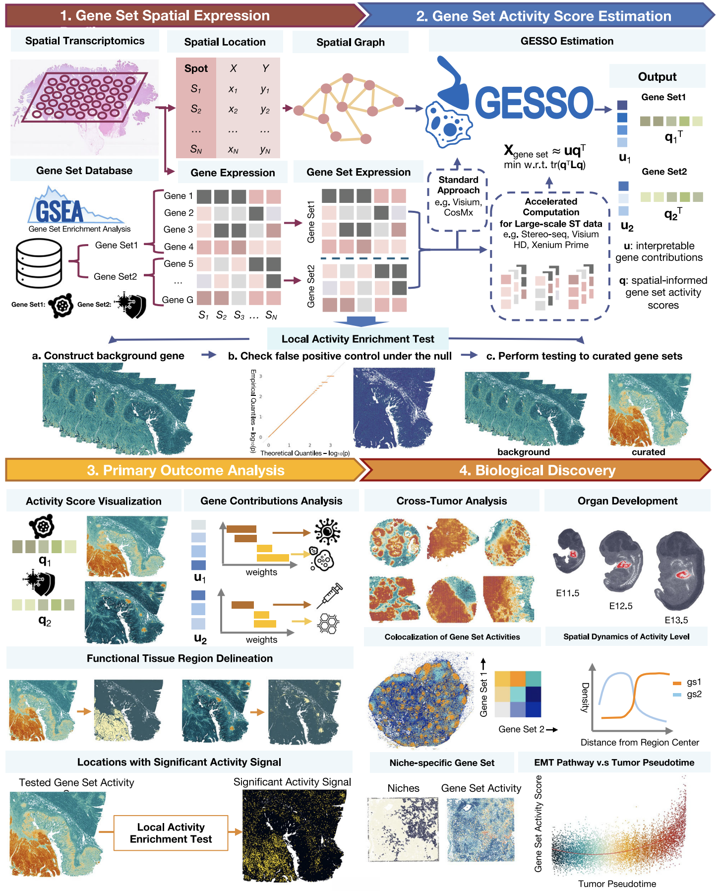

# GESSO: Spatial Gene Set Activity Analysis

GESSO (Gene sEt activity Score analysis with Spatial lOcation) is a computational method for
estimating spatially coherent gene set activity from spatial transcriptomics data.

This repository is the official Python implementation of GESSO. Please visit the [GESSO documentation](https://gesso-malab.readthedocs.io/) for tutorials and API details.

Current version: **0.2.0**. See the [changelog](https://github.com/YMa-lab/GESSO/blob/main/CHANGELOG.rst) for changes since 0.1.0.



*Figure 1. Overview of the GESSO workflow and applications. From the [GESSO paper in Nature Communications](https://doi.org/10.1038/s41467-026-78316-z).*

## Installation
The PyPI distribution name is `gesso-py`; the Python import remains
`from gesso import GESSO`. Until the first PyPI release is published, install
from source as shown below.

We recommend installing GESSO in a new Python environment. You can create a new Python environment through [conda](https://www.anaconda.com/docs/getting-started/miniconda/main):
```bash
conda create -n gesso python=3.12 -y
conda activate gesso
```

GESSO supports Python 3.12, 3.13, and 3.14. The example above uses 3.12; you can
substitute either of the other supported versions. The following script installs
GESSO into your Python environment:
```bash
git clone https://github.com/YMa-Lab/GESSO.git
cd GESSO
pip install .
cd ..
```

## Quick start

For Scanpy/Squidpy workflows, install optional AnnData support with
`pip install '.[anndata]'` from the repository, or install the plotting tutorial
dependencies with `pip install '.[tutorial]'`. GESSO itself requires neither
Scanpy nor Squidpy. Use `GESSO.from_anndata(adata, layer="counts")` to preserve
sparse expression and `report.write_to_anndata(adata)` to attach pathway scores.
See the [AnnData tutorial](https://gesso-malab.readthedocs.io/en/latest/anndata_tutorial.html)
for normalization choices and plotting examples.

GESSO processes spatial transcriptomics data along with a user-defined gene set/pathway and outputs a gene set activity score (GAS) for each spatial location.

Let's say your spatial transcriptomics dataset contains counts for $G$ genes across $N$ spots. You'll need to prepare an $N \times G$ expression `pd.DataFrame` as well as an $N \times 2$ locations `pd.DataFrame`. The indices of the two DataFrames must match. The locations DataFrame must contain two columns named `x` and `y`.

```python
import pandas as pd
from gesso import GESSO

# load data
expression_df: pd.DataFrame = ...
locations_df: pd.DataFrame = ...

# initialize a GESSO model
model = GESSO(
    expression_df=expression_df,
    locations_df=locations_df,
    k=20,
    normalize_counts_method="normalize-log1p"   # optional, use for raw data
)

# compute gene set activity scores
gas_report = model.compute_gas(
    genesets_dict={
        "example_geneset_1": ["gene1", "gene2", "gene3"],
        "example_geneset_2": ["gene4", "gene5", "gene6"],
    },
    n_jobs=2        # number of parallel jobs
)
gas_df = gas_report.gas_df()    # returns N by n_genesets df
gas_df.to_csv("gas_output.csv")

# test whether each spot exhibits significantly elevated gene set activity
htest_report = model.htest_elevated_gas(
    geneset="example_geneset_1",
    genes_in_geneset=["gene1", "gene2", "gene3"],
    n_permutations=500,     # number of random gene sets to sample
    n_jobs=8
)
htest_df = htest_report.htest_df()  # returns N by 4 df w/ columns 'x', 'y', 'gas', 'p'
htest_df.to_csv("htest_output.csv")
```

## Tutorials

The [documentation](https://gesso-malab.readthedocs.io/) includes a runnable tutorial using the small dataset bundled in `demo_data`, as well as demonstrations for several spatial transcriptomics platforms. The platform-scale demonstrations require the corresponding public datasets described in each notebook.

## AI-assisted analysis

The [gesso_vibe](https://github.com/YMa-lab/GESSO/tree/main/gesso_vibe) folder includes an analysis skill for
AI agents, with guidance on spatial data input, pathway scoring, and exporting
results through the GESSO Python API.

## Citation

If you use GESSO, please cite the following article and the specific GESSO software release used in your analysis:

Yang, A. J., Tan, C. & Ma, Y. Interpretable and scalable spatial gene set activity analysis with GESSO uncovers functional tissue architecture. *Nature Communications* (2026). https://doi.org/10.1038/s41467-026-78316-z

Machine-readable citation metadata are provided in [`CITATION.cff`](https://github.com/YMa-lab/GESSO/blob/main/CITATION.cff).

## License

GESSO is released under the [MIT License](https://github.com/YMa-lab/GESSO/blob/main/LICENSE).
