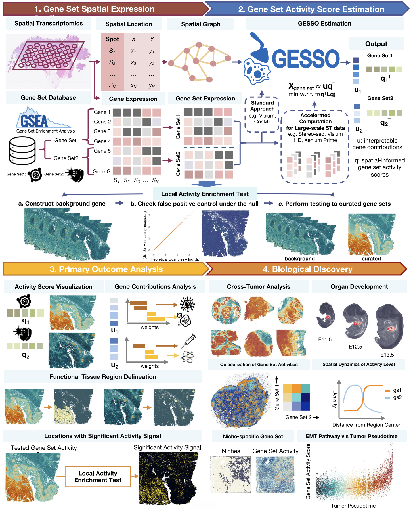

GESSO
=====
GESSO (Gene sEt activity Score analysis with Spatial lOcation) is a Python package
for spatially informed gene set activity analysis.

GESSO's source code can be found at `GitHub <https://github.com/YMa-lab/GESSO>`_.

   Figure 1. Overview of the GESSO workflow and applications. From the
   `GESSO paper in Nature Communications <https://doi.org/10.1038/s41467-026-78316-z>`_.

.. toctree::
   :maxdepth: 2
   :caption: Contents:

   intro
   api_reference

.. toctree::
   :maxdepth: 1
   :caption: Tutorials:

   gesso_demo_10xvisium.ipynb
   gesso_demo_stereoseq.ipynb
   gesso_demo_visiumhd.ipynb
   gesso_demo_xenium_prime.ipynb
   gesso_demo_cosmx.ipynb
   gesso_demo_behavior_at_extremes.ipynb

Citation
--------

If you use GESSO, please cite the following article and the specific GESSO software
release used in your analysis:

Yang, A. J., Tan, C. & Ma, Y. Interpretable and scalable spatial gene set activity
analysis with GESSO uncovers functional tissue architecture.
*Nature Communications* (2026).
`https://doi.org/10.1038/s41467-026-78316-z <https://doi.org/10.1038/s41467-026-78316-z>`_.
